# Guia operacional ilustrado — RC4

Este guia utiliza as capturas fornecidas e homologadas pelo usuário. Os passos pressupõem a execução local do app e a seleção da persona correspondente. A identificação de um Deal deve ser consistente ao comparar telas de uma mesma jornada.

## UAT-01 — Head — Executive Command Center

**Finalidade:** Visão executiva e indicadores.

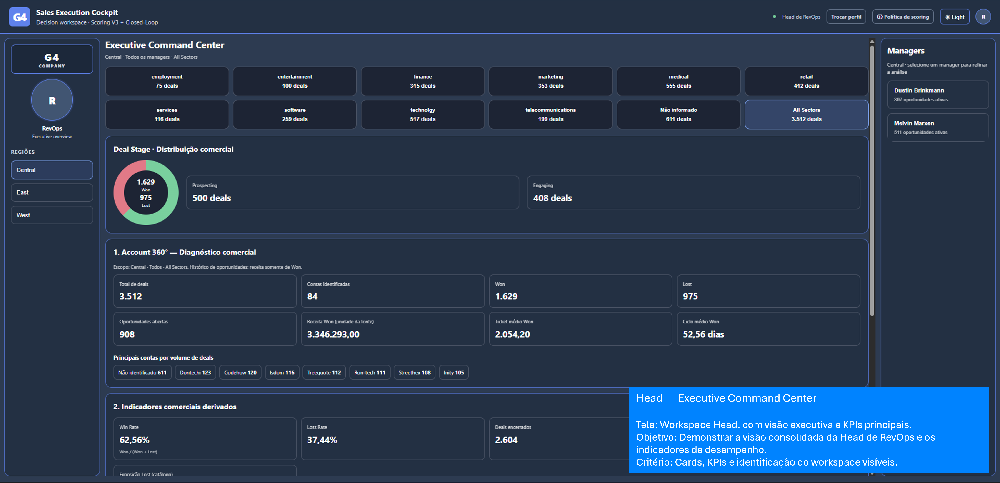

## UAT-02 — Head — Segmentação

**Finalidade:** Região, gerente e setor selecionados.

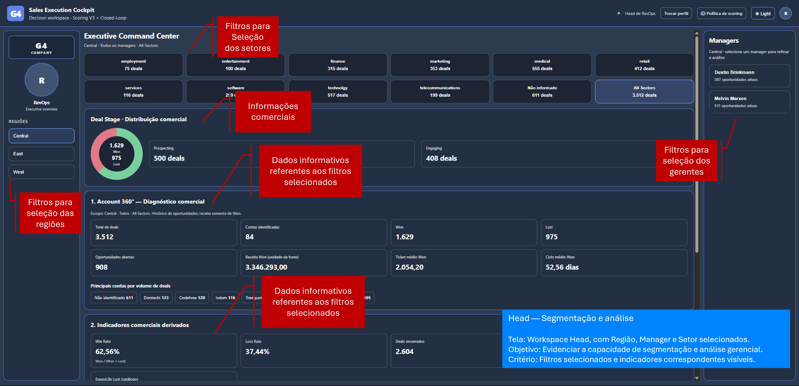

## UAT-03 — Manager — Performance

**Finalidade:** Comparação com os mesmos filtros do Head.

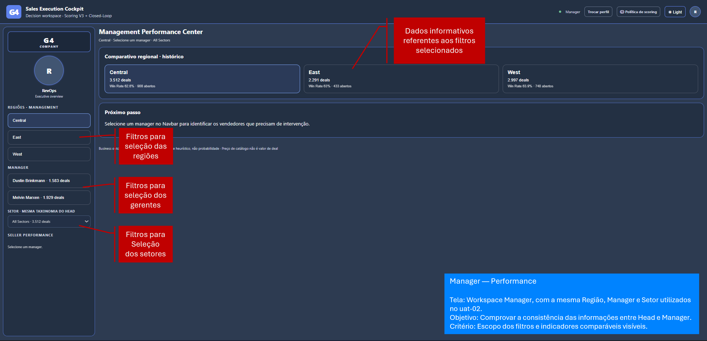

## UAT-04 — Seller — Pipeline

**Finalidade:** Fila comercial e priorização.

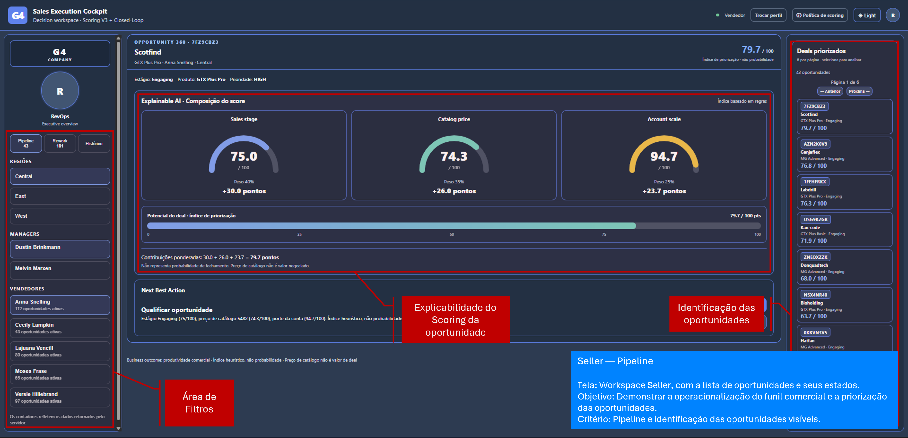

## UAT-05 — Seller — Opportunity 360

**Finalidade:** Contexto da oportunidade.

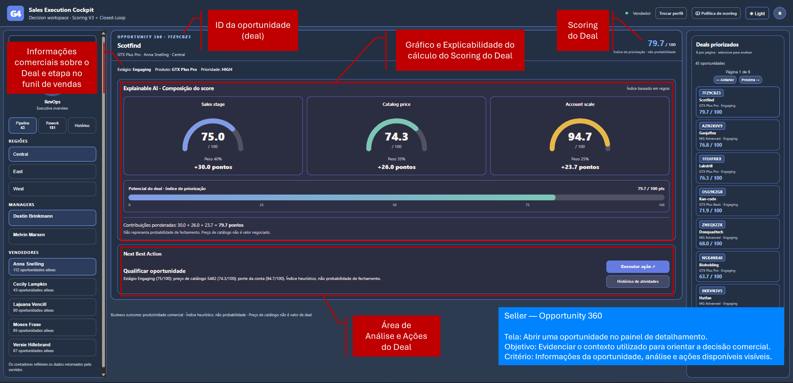

## UAT-06 — Qualification & Rework

**Finalidade:** Qualificação e pendências.

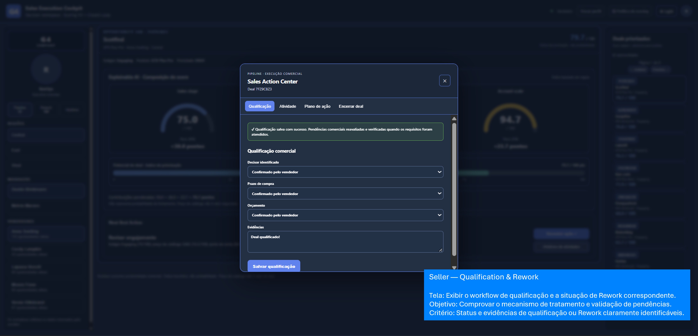

## UAT-07 — Deal Closure Won

**Finalidade:** Fechamento positivo.

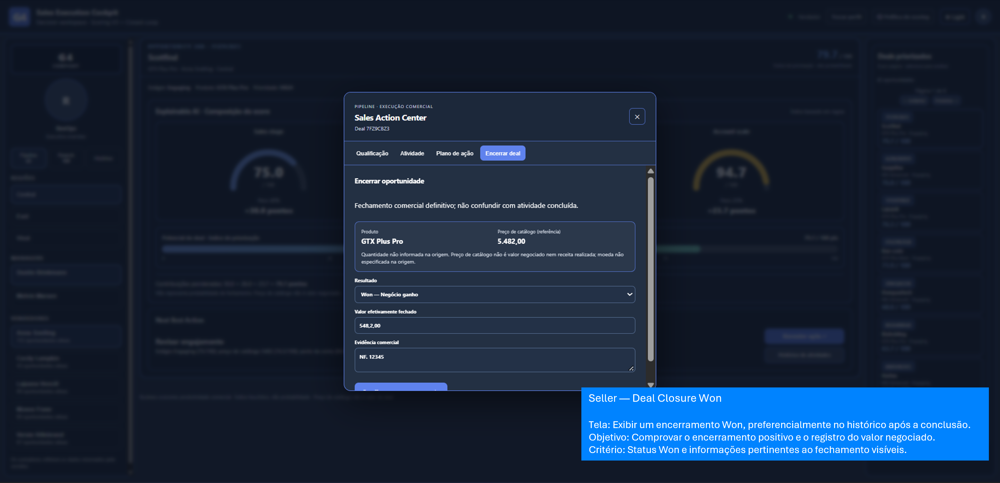

## UAT-08 — Deal Closure Lost

**Finalidade:** Fechamento perdido.

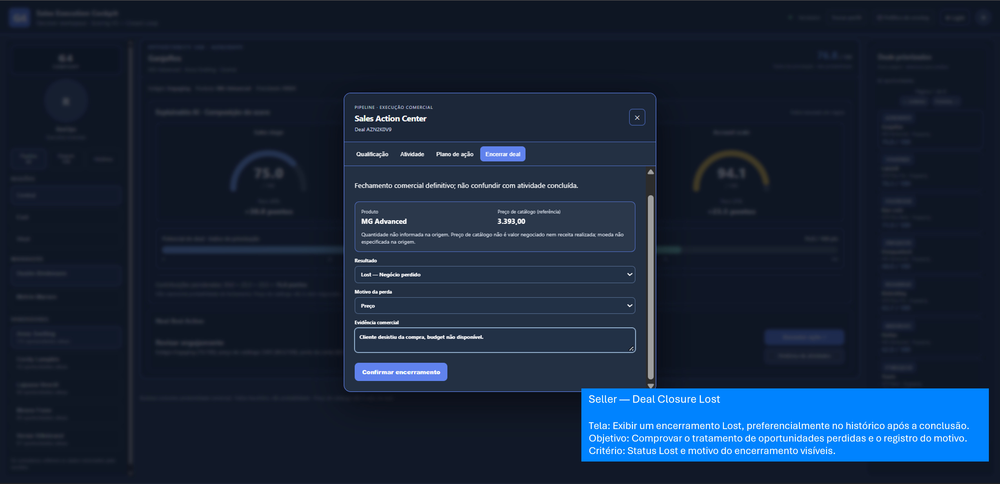

## UAT-09A — Rework E2E — AS-IS

**Finalidade:** Deal antes da correção.

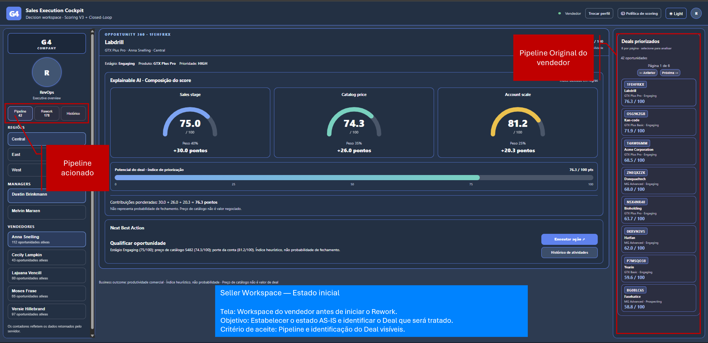

## UAT-09B — Rework E2E — Trigger

**Finalidade:** Detecção de Account não identificada.

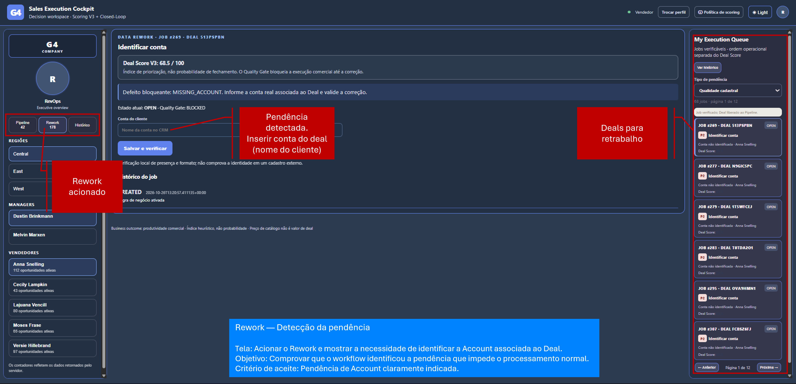

## UAT-09C — Rework E2E — Correction

**Finalidade:** Identificação/correção da Account.

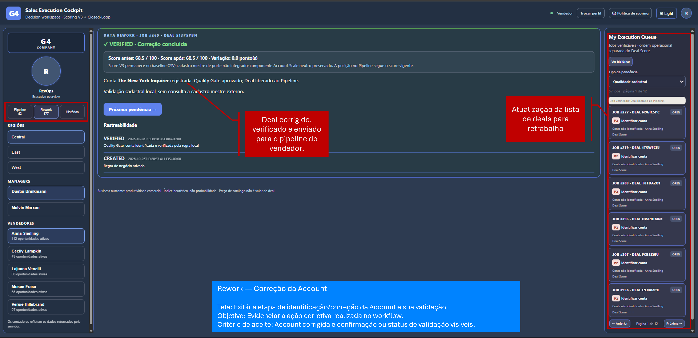

## UAT-09D — Rework E2E — TO-BE

**Finalidade:** Deal corrigido de volta ao Pipeline.

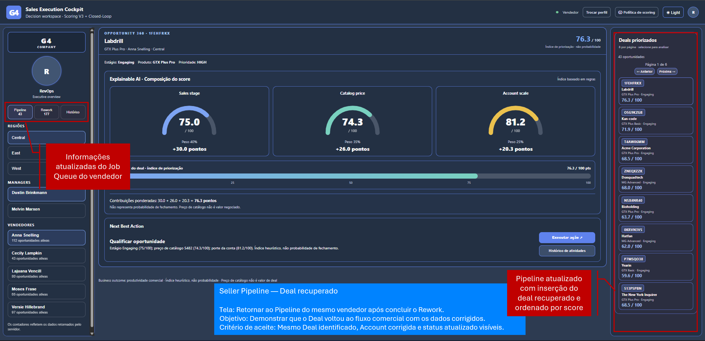

## Jornada Closed-Loop de Rework

1. **AS-IS (`uat-09a`)**: identificar o Deal no Pipeline do Seller.
2. **Detect (`uat-09b`)**: acionar o Rework e observar a pendência de identificação da Account.
3. **Correct (`uat-09c`)**: executar a identificação/correção e conferir o status apresentado.
4. **Verify (`uat-09d`)**: retornar ao Pipeline e localizar o Deal corrigido.

As capturas documentam o fluxo visual. A comprovação técnica de persistência depende dos testes e do banco de dados correspondente.
